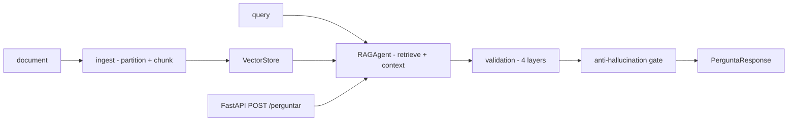

# agente-suporte-bancario-rag

**English** · [Português (Brasil)](README.md)

[](#) [](#) [](#) [](LICENSE)

## What it is

**A banking support RAG agent** (Retrieval-Augmented Generation): a **FastAPI API** that **ingests documents** (PDF/text → overlapping chunks), **indexes embeddings** (hash/cosine or a pluggable provider), answers questions with **retrieved context** and applies **4 validation layers** on the output — anti-hallucination, source consistency, policy compliance — including a configurable **anti-hallucination gate**. It is an educational applied-RAG lab.

## Status

An educational lab, working and tested (39 tests). Default embedding: hash (+cosine) with no external dependency; PgVector and other providers are pluggable.

## Features

- **Ingestion** (`ingest.py`): `particionar` with chunk-size (200) and overlap (40), `ingestar` that chunkifies and stores.
- **Embeddings** (`embeddings.py`): `EmbeddingProvider` (Protocol) with `HashEmbedding` and `similaridade_coseno`.
- **Vector Store** (`vector_store.py`): `VectorStore` (Protocol) with `InMemoryVectorStore` and `PgVectorStore`.
- **RAG** (`rag.py`): `RAGAgent` — retrieves chunks, builds context, generates answers with the configured model.
- **Validation** (`validation.py`): 4 layers: `camada_saida` (coverage), `camada_fonte` (citations), `camada_consistencia`, `camada_politica` — each returns a `LayerResult`.
- **Anti-hallucination** (`anti_hallucination.py`): `gate_anti_alucinacao` with a configurable max-similarity threshold.
- **Citations** (`citations.py`): `extrair_citacoes` + `montar_citacoes`.
- **API** (`main.py`): `GET /health`, `POST /ingest`, `POST /perguntar` (Pydantic models), `ValidationReport` and `RAGResponse`.
- **CLI** (`agente-suporte-bancario`): standalone mode.

## Architecture

A FastAPI with layers: ingest → embeddings → vector store → RAG → validation → generation. Everything is pluggable (providers, stores). Configuration via `config.py` (Settings).



## Stack

- Python ≥ 3.10
- FastAPI ≥ 0.100, Pydantic ≥ 2.0, uvicorn ≥ 0.20
- pytest (dev)

## Repository layout

```
agente-suporte-bancario-rag/
├── pyproject.toml · BRIEF.md
├── src/agente_suporte_bancario_rag/
│   ├── main.py · config.py · models.py · prompts.py
│   ├── ingest.py · embeddings.py · vector_store.py
│   ├── rag.py · validation.py · anti_hallucination.py · citations.py
├── tests/             # 39 tests
└── LICENSE            # MIT
```

## Prerequisites and installation

```bash
pip install -e .
```

## How to run

```bash
agente-suporte-bancario          # CLI (standalone)
uvicorn agente_suporte_bancario_rag.main:app  # FastAPI
```

## Tests and quality

Real command (verified by the agent):

```bash
PYTHONPATH=src python -m pytest tests/
# 39 passed
```

## Technical decisions and trade-offs

- **Hash-based embedding** (no network): functional RAG offline; replaceable by a real embedding via `EmbeddingProvider`.
- **4 validation layers**: the output is audited before responding; the `gate_anti_alucinacao` cuts answers with suspicious similarity.
- **PgVector and InMemory**: interchangeable vector stores.

## Known limitations and roadmap

- Hash embedding is deterministic and local (no deep semantics — it reinforces the vocabulary present).
- Does not include a bundled LLM (it consumes whatever model `config.py` points to).

## Development process

An individual project by Kelvin Oliveira, built with orchestrated AI agents and reviewed by the author.

## License and author

MIT — Copyright (c) 2026 Kelvin Rebelo de Oliveira. Author: [Kelvin Oliveira](https://github.com/KelvinOliveiraCode) · [Portfolio](https://kelvinoliveiracode.github.io/portfolio/)
