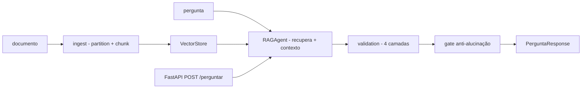

# agente-suporte-bancario-rag

[English](README.en.md) · **Português (Brasil)**

[](#) [](#) [](#) [](LICENSE)

## O que é

**Agente de suporte bancário com RAG** (Retrieval-Augmented Generation): uma API **FastAPI** que **ingesta documentos** (PDF/texto → chunks com sobreposição), **indexa embeddings** (hash/cosseno, ou provider plugável), responde perguntas com **contexto recuperado** e aplica **4 camadas de validação** na saída — anti-alucinação, consistência com fontes, conformidade política — incluindo um **gate anti-alucinação** configurável. É um laboratório educacional de RAG aplicado.

## Status

Laboratório educacional funcional e testado (39 testes). Embedding base: hash (+cosseno) sem dependência externa; PgVector e outros providers são plugáveis.

## Funcionalidades

- **Ingestão** (`ingest.py`): `particionar` com tamanho (200) e sobreposição (40), `ingestar` que chunkifica e armazena.
- **Embeddings** (`embeddings.py`): `EmbeddingProvider` (Protocol) com `HashEmbedding` e `similaridade_coseno`.
- **Vector Store** (`vector_store.py`): `VectorStore` (Protocol) com `InMemoryVectorStore` e `PgVectorStore`.
- **RAG** (`rag.py`): `RAGAgent` — recupera chunks, monta contexto, gera resposta com o modelo configurado.
- **Validação** (`validation.py`): 4 camadas: `camada_saida` (cobertura), `camada_fonte` (citações), `camada_consistencia`, `camada_politica` — cada uma retorna `LayerResult`.
- **Anti-alucinação** (`anti_hallucination.py`): `gate_anti_alucinacao` com threshold de similaridade máxima.
- **Citações** (`citations.py`): `extrair_citacoes` + `montar_citacoes`.
- **API** (`main.py`): `GET /health`, `POST /ingest`, `POST /perguntar` (modelos Pydantic), `ValidationReport` e `RAGResponse`.
- **CLI** (`agente-suporte-bancario`): execução standalone.

## Arquitetura

FastAPI com camadas: ingest → embeddings → vector store → RAG → validação → geração. Tudo plugável (providers, stores). Config via `config.py` (Settings).



## Stack

- Python ≥ 3.10
- FastAPI ≥ 0.100, Pydantic ≥ 2.0, uvicorn ≥ 0.20
- pytest (dev)

## Estrutura do repositório

```
agente-suporte-bancario-rag/
├── pyproject.toml · BRIEF.md
├── src/agente_suporte_bancario_rag/
│   ├── main.py · config.py · models.py · prompts.py
│   ├── ingest.py · embeddings.py · vector_store.py
│   ├── rag.py · validation.py · anti_hallucination.py · citations.py
├── tests/             # 39 testes
└── LICENSE            # MIT
```

## Pré-requisitos e instalação

```bash
pip install -e .
```

## Como executar

```bash
agente-suporte-bancario          # CLI (modo standalone)
uvicorn agente_suporte_bancario_rag.main:app  # API FastAPI
```

## Testes e qualidade

Comando real (verificado pelo agente):

```bash
PYTHONPATH=src python -m pytest tests/
# 39 passed
```

## Decisões técnicas e trade-offs

- **Embedding hash-based** (sem rede): RAG funcional offline; substituível por embedding real via `EmbeddingProvider`.
- **4 camadas de validação**: a saída é auditada antes de responder; o `gate_anti_alucinacao` corta respostas com similaridade suspeita.
- **PgVector e InMemory**: vector stores intercambiáveis.

## Limitações conhecidas e roadmap

- Embedding hash é determinístico e local (não captura semântica profunda — só reforça o vocabulário presente).
- Não inclui um LLM embarcado (consome o modelo configurado pelo `config.py`).

## Processo de desenvolvimento

Projeto individual de Kelvin Oliveira, construído com agentes de IA orquestrados e revisado pelo autor.

## Licença e autor

MIT — Copyright (c) 2026 Kelvin Rebelo de Oliveira. Autor: [Kelvin Oliveira](https://github.com/KelvinOliveiraCode) · [Portfólio](https://kelvinoliveiracode.github.io/portfolio/)
